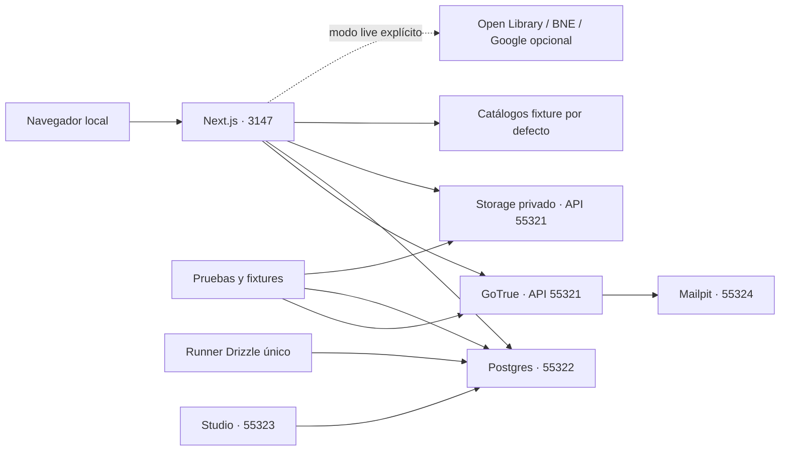

# Spec de cierre de auditoría y evolución de BibLib

**Versión:** 1.0 · **Fecha:** 22 de octubre de 2026 · **Estado:** propuesta de trabajo, pendiente de implementar.

Esta especificación cubre los pendientes de los 35 hallazgos de la auditoría, sus ampliaciones de producto y los requisitos añadidos: Supabase local completo y búsqueda bibliográfica con varios proveedores, priorizando servicios gratuitos. Se organiza en **45 unidades, cinco fases y 17 olas numeradas O00–O16**. O00 prepara la ejecución; las otras olas entregan incrementos verificables. Los números no representan semanas ni compromisos de fecha.

La especificación es un resultado documental. No instala Supabase, no crea scripts ejecutables todavía, no aplica SQL ni cambia configuración de producción. Los nombres de archivos y comandos marcados como propuestos definen lo que deberá implementarse.

## Documentos y autoridad

| Documento | Contenido |
| --- | --- |
| [01 · Entorno y migraciones](01-entorno-y-migraciones.md) | Referencia real de HolaERP, stack propio, configuración, scripts, Auth/Storage reales, fixtures, reset y migración por entorno. |
| [02 · Datos, importación y catalogación](02-datos-importacion-y-catalogacion.md) | Revisión de colección, deshacer, trabajos, partes, cuotas, obra/edición/ejemplar, revisión, título/autor, CSV y assets. |
| [03 · Experiencia y funciones](03-experiencia-y-funciones.md) | Navegación, accesibilidad, vistas, escáner, avatar, impresión, offline, notas, lectura, ubicaciones, préstamos y series. |
| [04 · Calidad, seguridad y operación](04-calidad-seguridad-y-operacion.md) | Pruebas reales, navegadores, capacidad, CI, cierre de auditoría, observabilidad, respaldos, eliminación y mantenimiento. |
| [05 · Fases, olas y trazabilidad](05-fases-olas-y-trazabilidad.md) | Secuencia completa, paralelismo, puertas, riesgos y correspondencia de los 35 hallazgos. |
| [06 · Proveedores bibliográficos](06-proveedores-bibliograficos.md) | Open Library, BNE, Google Books opcional, adaptadores, fuentes por campo, conflictos, costes, cuotas y pruebas. |
| [Orquestación de F0](orquestacion-f0.md) | Decisiones de O00, reglas comunes, contrato compartido, reparto de agentes y puertas de O01–O06. |
| [Orquestación de F1](orquestacion-f1.md) | Reglas añadidas, reparto de agentes y puertas de O07–O10. |
| [Registro de unidades](unidades.json) | ID, fase, ola, dependencias obligatorias, tamaño, prioridad, documento y hallazgos relacionados. Todos empiezan en `planned`. |

El registro fija el **orden de entrega y las dependencias obligatorias**; los documentos de unidad fijan contratos y aceptación. Una referencia a una integración futura no añade una dependencia circular: debe diferenciarse del prerrequisito de entrega. Si cambia una decisión, actualizar la unidad, registro y ola afectados en la misma propuesta. El código existente y el informe de implementación son evidencia del punto de partida, no de que esta spec esté terminada.

Referencias históricas: [auditoría](../auditoria-2026-10-22.md), [estado implementado](../implementacion-2026-10-22.md) y [operación actual](../operacion.md). No reescribir el diagnóstico original como si hubiera observado los cambios posteriores.

## Punto de partida y objetivos de salida

El código actual tiene edición completa, organización, catálogo paginado, filtros URL, revisión JSON, fusión/reemplazo confirmado, portadas, exportación fragmentada y control de versión individual. La última validación registrada obtuvo 50 pruebas unitarias, pruebas SQL aisladas y 12 grupos de navegador. Ese resultado utiliza Auth simulado en los recorridos; no demuestra GoTrue/Google ni Storage reales en un despliegue. No se han aplicado desde esta sesión las migraciones `0001` y `0002` a la base real.

Al terminar el plan, una persona que clone el repo debe poder:

1. Preparar un stack Supabase propio y abrir BibLib en local sin conexión con la biblioteca de producción.
2. Autenticarse y probar sesiones, permisos y archivos con servicios reales locales; ejecutar escenarios externos opcionales por separado.
3. Reconstruir la base desde las mismas migraciones que se aplican en preproducción y producción, con fixtures ficticios reproducibles.
4. Consultar varios catálogos desde el mismo flujo, ver fuentes y discrepancias y guardar una ficha revisada sin confundir ISBN válido con edición física comprobada.
5. Importar, restaurar, recuperar un reemplazo y reanudar trabajos sin datos parciales ni duplicados por reintento.
6. Catalogar varias copias de una edición y libros sin ISBN, conservando los enlaces y datos legacy definidos por la migración.
7. Usar las funciones privadas de lectura y colección previstas, con exportación completa, accesibilidad y aislamiento entre cuentas.
8. Migrar y recuperar un entorno remoto siguiendo un plan identificable, con respaldo ensayado y evidencia del resultado.

## Qué significan unidad, fase y ola

- **Unidad:** incremento con objetivo, entregables, contratos, dependencias, aceptación, pruebas, migración y recuperación. Puede contener subtareas y varios PR; no se cierra por haber creado solo su tabla o pantalla.
- **Fase:** objetivo del producto y condición de salida. La operación y las pruebas empiezan antes del cierre final; no se posponen para el último día.
- **Ola:** conjunto de entregas que se integra y valida junto. Sus carriles pueden trabajar en paralelo si las dependencias y propiedad de archivos lo permiten. Las dependencias internas de una ola se ejecutan en orden, no simultáneamente por conveniencia.
- **Puerta:** evidencia concreta para pasar a la siguiente entrega dependiente. Una dependencia bloqueada no se sustituye por un mock sin actualizar el alcance.

| Fase | Objetivo | Puerta de salida |
| --- | --- | --- |
| F0 · Base local reproducible | Servicios reales, objetivos explícitos, migraciones canónicas, fixtures y diagnóstico. | Desde un clon limpio se reconstruye y prueba el stack sin credenciales remotas ni interferir con HolaERP. |
| F1 · Integridad e integración bibliográfica | CAS de colección, proveedores, cuotas, trabajos y recuperación inicial; preparación remota. | Revisión antigua no reemplaza datos nuevos; resultados bibliográficos y fallos son trazables; operaciones sobreviven a reintentos. |
| F2 · Modelo y experiencia completos | Restauración conjunta, assets, ejemplares, revisión, CSV y experiencia accesible. | Legacy y formato nuevo hacen ida/vuelta; las tareas principales son completas, privadas y recuperables. |
| F3 · Lectura y colección física | Notas, lectura, ubicaciones, préstamos, series, impresión y consulta offline explícita. | Todas las funciones nuevas tienen contratos, exportación, eliminación y pruebas de cuenta cruzada. |
| F4 · Verificación y operación de la entrega | Cerrar pendientes remotos, capacidad, recuperación y auditoría con evidencia. | Matriz de 35 hallazgos cerrada o con decisiones de aplazamiento visibles; release y recuperación ensayados. |

Las olas O01–O06 construyen F0; O07–O10 concentran F1; O11–O13 concentran F2; O13–O15 incorporan F3; O16 cierra F4. Hay trabajo transversal de seguridad, pruebas y operación en todas ellas. El registro indica la fase principal de cada unidad.

## Decisiones de arquitectura de esta propuesta

### A01 · Supabase propio de BibLib

Tomar el patrón de servicios completos de `C:/Users/ncaso/Trabajo/Codigo/holaerp-web`, descrito con los archivos consultados en [01](01-entorno-y-migraciones.md). BibLib tiene proyecto `biblib-local`, puertos 55320–55329, aplicación 3147, red/volúmenes y estado propios. No comparte el Postgres de HolaERP ni copia sus esquemas o fixtures.



El bootstrap debe comprobar salud, versiones y propiedad antes de escribir. Detectar un puerto ocupado produce diagnóstico; no termina procesos ni para stacks ajenos. CI y worktrees usan perfiles separados. No se considera aislado un recurso solo porque su URL diga `localhost`.

### A02 · Un historial de migraciones, objetivos explícitos

Drizzle mantiene las migraciones de negocio y su ledger; Supabase CLI mantiene la plataforma local. Conservar `0000`, `0001`, `0002`, journal, snapshots y el trigger SQL. No duplicar el mismo DDL en dos sistemas ni hacer squash del historial existente para añadir local.

Los wrappers distinguen `local`, `test`, `preprod` y `prod` con `BIBLIB_TARGET`. Preproducción/producción no cargan `.env.local` de desarrollo. Los comandos genéricos ambiguos se retiran o se convierten en despachadores que exigen objetivo; generar SQL es offline y no genera ni ejecuta cambios distintos según el entorno.

No reescribir un SQL aplicado para normalizar saltos de línea y «arreglar» un hash. El diagnóstico debe reconocer el historial real, incluidos hashes legacy de Windows, y exigir una adopción documentada cuando corresponda. Los archivos nuevos tienen formato estable.

### A03 · Gratis primero, con proveedores intercambiables

El flujo base no exige claves de pago: Open Library y BNE, usando APIs documentadas y respetando sus condiciones. Google Books es un adaptador opcional, apagado hasta verificar configuración, cuota/coste y uso previsto. No se activa facturación desde los scripts ni se contrata otro servicio como fallback automático.

El requisito de gratuidad se aplica a los proveedores bibliográficos elegidos; no promete que alojamiento, almacenamiento o respaldos de producción carezcan de coste. Los servicios locales y las pruebas con fixtures funcionan sin claves de esos proveedores ni llamadas externas.

`BIBLIB_CATALOGUE_MODE=fixture|live` es de servidor y `fixture` es el valor local/test inicial. Alta, búsqueda, importación y recuperación utilizan el mismo servicio. La fuente de una portada puede diferir de la de los metadatos. Cada fallo conserva su significado; una cuota agotada nunca se transforma en «libro inexistente».

### A04 · Datos privados e identidad estable

Obras, ediciones y ejemplares serán privados por cuenta en esta etapa. El catálogo público de un proveedor no vuelve públicas notas, préstamos, inventario ni consultas de un usuario. Las relaciones privadas incluyen propietario y no aceptan una referencia a B desde una operación de A.

El ID de ficha actual pasa al ejemplar para conservar enlaces. ISBN-13 es opcional en la edición; se admiten varias copias. `manual-...` se conserva como identificador legacy, separado de ISBN. Los campos de lectura, ubicación y préstamo pertenecen al ejemplar; la descripción bibliográfica pertenece a la edición.

**`isbnVerified` conserva su significado actual: comprobación humana del ISBN en el ejemplar físico.** Un checksum válido, una portada, una coincidencia de proveedor o una foto de lomo no activan ese indicador. El checksum es una validación derivada distinta.

### A05 · Revisiones, staging y publicación atómica

Una versión de ficha no protege toda la colección. Añadir revisión de colección, planes privados caducables, confirmación sobre esa revisión e idempotencia persistente. Cualquier cambio relevante invalida un reemplazo preparado antes; el usuario vuelve a revisar diferencias.

Los trabajos usan Postgres y un ejecutor acotado antes de justificar una cola externa. Los lotes se preparan en staging; publicar una restauración conjunta es una transacción final sin red y con presupuesto. Un timeout revierte todo y conserva staging para revisión. No presentar varios commits parciales como una restauración atómica. Generaciones/punteros activos son una alternativa de escala condicionada a medición y ADR completo.

### A06 · Formatos y compatibilidad

| Concepto | Convención propuesta |
| --- | --- |
| Entrada antigua | Se siguen leyendo `{ books, shelves }` y JSON v1. |
| Copia portable nueva | `formatVersion: 2`, con obras/ediciones/ejemplares y secciones opcionales conocidas de producto; nace en U-BIB-04 mediante adaptador legacy y U-DAT-06 reutiliza el mismo esquema al separar tablas. |
| Conjunto de partes | `bundleVersion: 1`, manifest de integridad con hashes de bytes exactos, orden y cantidades. Es independiente del payload. |
| Procedencia ampliada | `catalogue.schemaVersion: 2` cuando corresponda; lector compatible con el objeto actual. |
| Tokens de concurrencia | UUID/revisiones efímeras del servidor; no se restauran como permiso de escritura. |
| Formato interno de snapshot/job | Versión propia de contrato; no se deduce de `formatVersion` del usuario. |

Un lector que no puede conservar una sección requerida rechaza la operación con explicación; no elimina datos desconocidos silenciosamente. Extensiones posteriores de v2 declaran capacidades/secciones y su tratamiento. No inventar ISBN para poder exportar v1 ni omitir una copia adicional. El formato v1 de salida solo se ofrece cuando no produce pérdida y muestra sus límites.

Antes de separar tablas, la exportación v2 representa cada fila legacy como una copia y una edición, con IDs estables en sus respectivos namespaces y obra desconocida. El lector declara capacidades soportadas y rechaza un v2 que requiera varias copias o funciones todavía no representables. No se crean dos contenidos incompatibles bajo `formatVersion: 2` ni se espera a la migración de ejemplares para respaldar procedencia BNE. Verificación física, tokens y fuente editorial siguen siendo conceptos separados.

Las pruebas de compatibilidad usan un fixture **sintético de 111 fichas** con forma, procedencia y estados equivalentes a los archivos existentes. El catálogo y las fotos personales solo participan en un ensayo privado elegido expresamente, fuera de CI y de los artefactos públicos.

### A07 · Interfaz, imágenes y acceso sin conexión

Se conserva español, estética vintage, contraste en ambos temas y fallback `/default-book-cover.webp`. El visor 3D sigue como alternativa paginada accesible; no se incorpora rotación/zoom libre en este plan. La cámara es opcional, se activa por acción y siempre tiene alternativa manual.

Assets privados y sus bytes se respaldan según política propia. Una URL externa no es una copia local y una URL firmada caducable no es un respaldo portable. Cache, copia de imagen, exportación y offline respetan las condiciones de cada fuente; no se aplican derechos de metadatos a portadas por inferencia.

La PWA comienza con shell estático. La copia privada de solo lectura es opt-in, particionada por cuenta, con desbloqueo/expiración y purga. No cachear de manera genérica respuestas autenticadas ni prometer revocación remota instantánea cuando un dispositivo está desconectado. No se implementan escrituras offline ni sincronización bidireccional.

## Contrato mínimo de los scripts

El catálogo propuesto de comandos, argumentos, códigos de salida y guardas está en [01](01-entorno-y-migraciones.md). El recorrido previsto, **todavía no ejecutable**, es:

```text
Preparación:     pnpm db:local:doctor → pnpm db:local:bootstrap
Desarrollo:     pnpm dev:local
Diagnóstico:    pnpm db:local:status → pnpm db:status:local
Cambio schema:  pnpm db:generate → revisión SQL → pnpm db:plan:local → pnpm db:migrate:local
Fixtures:       pnpm db:seed:local
Reconstrucción: pnpm db:reset:local <argumentos de propiedad definidos en 01>
Integración:    pnpm test:integration:local → pnpm test:e2e:local
Preproducción:  status → plan → backup/ensayo → migrate → smoke del destino
Producción:     status → plan revisado → respaldo válido → migrate explícito → verificación
```

La generación nunca depende del destino remoto. Una planificación es de solo lectura; aplicar exige identidad y hash del plan vigentes. Reset/seed de demo son locales: este plan no crea comandos ordinarios `truncate:prod` ni `seed:prod`.

El entorno local permite probar GoTrue, cookies SSR, RLS, FK, Storage, firma de URLs, correo local, jobs y migraciones reales. Google OAuth externo, disponibilidad/cuota real de catálogos, configuración del CDN, planes del proveedor y entrega remota se verifican de forma conectada adicional. No se afirma que esos sistemas externos queden reproducidos íntegramente sin Internet.

## Definición de unidad preparada y terminada

**Preparada:** dependencias identificadas; código actual revisado; contrato/migración propuestos; riesgo de datos, límites y recuperación descritos; fixtures disponibles; propiedad de archivos acordada; decisiones abiertas que bloquean esa unidad resueltas en un ADR breve.

**Terminada:**

1. Comportamiento y criterios de aceptación demostrados, incluidos error, vacío, reintento y concurrencia aplicables.
2. Migración desde vacío y desde la versión anterior, integridad, RLS y grants verificados en local real para cambios de dominio.
3. Compatibilidad de import/export, IDs, fuentes y formato anterior comprobada si el cambio afecta datos persistidos.
4. Pruebas apropiadas, lint/tipos y build cuando cambie ejecución. Suite integrada al cerrar ola; sin repetición innecesaria por cambios documentales.
5. Accesibilidad, idioma y móviles revisados para UI; no éxitos ficticios ni pérdida de borradores por error recuperable.
6. Registro de eliminación/retención y respaldo ampliado a cada tabla/asset nuevo. Ningún worker recrea datos de una cuenta en eliminación.
7. Documentación, comandos y evidencia actualizados; no fotos, tokens o datos de biblioteca en capturas públicas.
8. Estado local/preproducción/producción diferenciado. La aceptación de implementación no inventa un despliegue o una prueba externa pendientes.

## Coordinación, decisiones abiertas y alcance

Hasta tres carriles de implementación más coordinación encajan en la capacidad actual y respetan el máximo de cinco solicitado. Un carril suele poseer DB/migraciones; otro acciones/proveedores; otro UI/pruebas. No escribir en paralelo el schema, journal, package/lockfile, el mismo formulario o el publicador de importaciones. Un cambio de contrato se integra antes de que sus consumidores dependan de él.

Tamaños S/M/L son relativos: no sumar automáticamente estimaciones ni multiplicar capacidad por número de agentes. Las migraciones, decisiones de datos y validación compartida limitan el paralelismo.

O00 debe confirmar la versión exacta del CLI a fijar —2.117.0 es la referencia observada en HolaERP—, puertos disponibles, versión/configuración remota cuando exista autorización para diagnosticarla, alojamiento del worker y condiciones de Google Books. Estas comprobaciones no bloquean la redacción ni autorizan por sí mismas una migración real. Cada condición tiene un responsable/unidad y una salida clara en el plan de olas.

Quedan fuera de alcance: red social, recomendaciones complejas, catálogo privado compartido públicamente, otro motor 3D, sincronización de escrituras offline y servicios de pago obligatorios para buscar ISBN. Las decisiones expresas de alcance cuentan como trazabilidad, no como funcionalidades implementadas.
