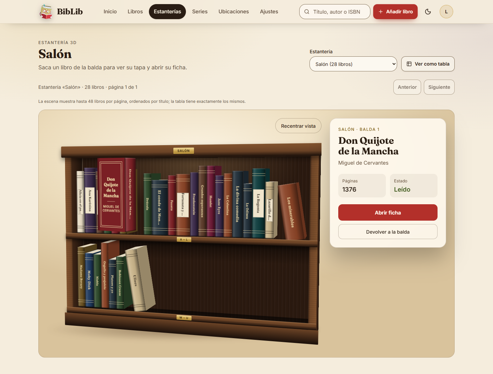
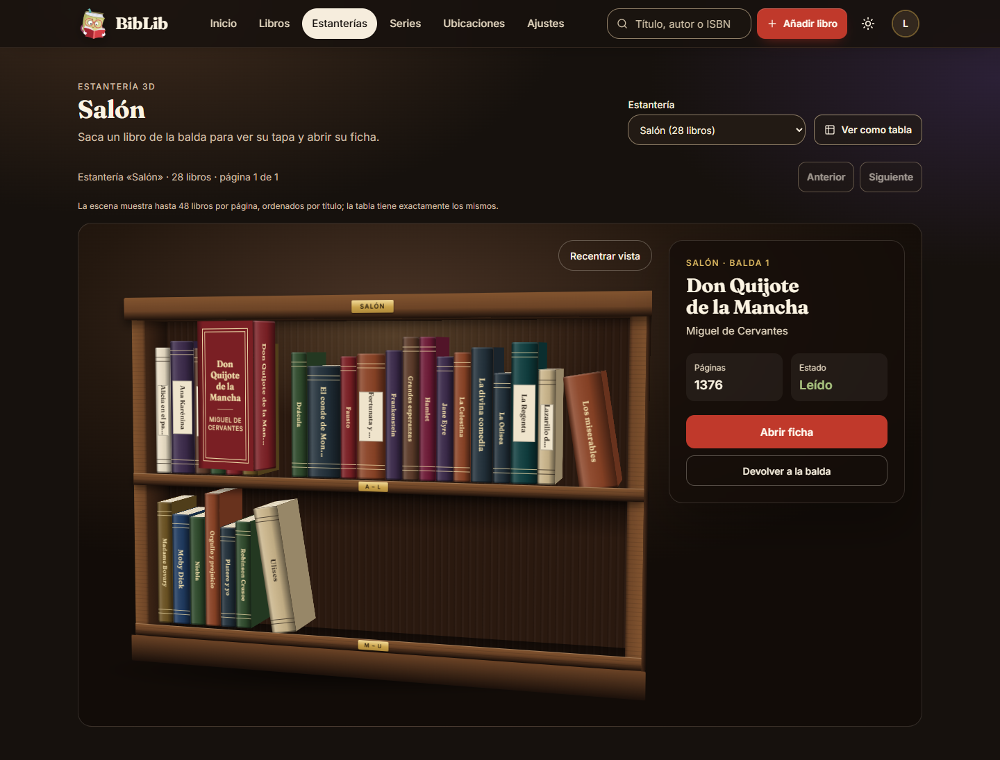
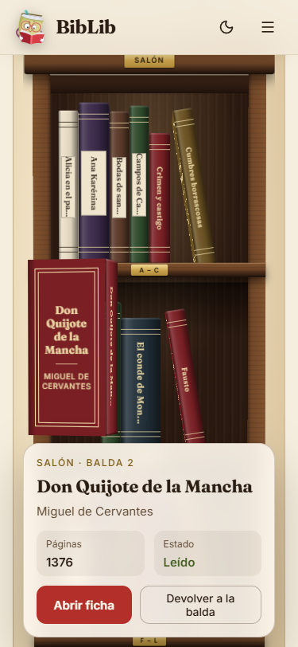
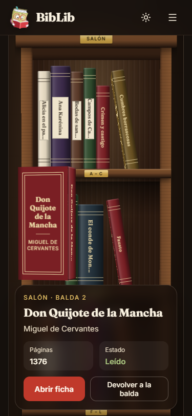

# U-UX-02 · Estantería 3D realista

**Fecha:** 25–26 de octubre de 2026 · **Ramas:** `u-ux-02` (hija de `feature/spec-pendientes`) y `u-ux-02-stack` = `u-ux-02` + `feature/spec-pendientes` con U-UX-01 y 0015, donde se hicieron el ajuste a «Biblioteca nocturna», el turno de stack y la evidencia (worktree `u-qa-01`, perfil `test`) · **Agente:** Claude (Opus) · **Ola:** O14, en paralelo con U-UX-01.

Spec: [07 · Rediseño](../../../../spec-pendientes/07-rediseno.md) y U-EXP-04 en [03](../../../../spec-pendientes/03-experiencia-y-funciones.md). Prototipo aprobado: `docs/diseno/prototipo/estanteria-3d.dc.html`.

## Qué se hizo

La escena se reimplementó en React con CSS 3D, sin dependencias nuevas, con la geometría del prototipo:

- **Mueble:** fondo, laterales, techo, baldas (cara superior, inferior y canto), sombra en el fondo bajo cada balda, montantes, cornisa, zócalo y placas de latón. La cornisa lleva el nombre de la estantería y cada canto, el tramo alfabético de su balda («A – L»). El zócalo queda bajo el canto de la última balda para que su placa se vea (en el prototipo la tapaba).
- **Libros como cajas:** lomo, tapa (cara izquierda), contratapa, canto de páginas y `preserve-3d`. Hay tres tipos de lomo: tela con nervios, bloque liso y etiqueta de papel. La trasera solo se pinta en el libro sacado, porque en la balda nunca se ve; así cada libro tiene cuatro caras.
- **Interacción:**
  - El último libro de cada balda se inclina en su hueco (`rotateZ(-9deg)`, 34 px).
  - Al pasar el puntero o el foco, el libro asoma (`translateZ(26px) translateY(-6px)`).
  - Al seleccionarlo, sale y gira para enseñar la tapa (`translateZ(190px) translateY(-26px) rotateY(76deg)`).
  - El panel lateral muestra la ficha.
  - El mueble gira levemente con el ratón; «Recentrar vista» lo devuelve.
- **Madera:** se elige con `data-madera` (`nogal` por defecto, `roble` y `ebano`) y la prop `wood`. Madera, sala y latón son variables propias (`--s3-*`). Tras integrar U-UX-01, el visor toma de sus tokens la acción (`--primary`/`--primary-foreground`), el foco (`--ring`), el latón de texto (`--brass-text`), los estados (`--status-*`) y las fuentes Fraunces e Inter (`--font-fraunces`/`--font-inter`), siempre con un valor por defecto propio. El tema oscuro solo cambia la sala y el panel (selector `.dark`).

### Contrato (`app/shelves/3d/viewer-contract.ts`)

Solo deriva datos que ya existen, sin cambios de esquema:

- **Grosor por páginas:** `spineThicknessFor`, 1 px cada 26 páginas, acotado a 24–52 px. El mínimo de 24 px mantiene el objetivo táctil de WCAG 2.5.8.
- **Rasgos estables por id** (huella FNV-1a, `sceneBookHash`):
  - altura (`spineHeightFor`, 150–208 px, por debajo de la balda superior aunque el libro asome);
  - color de tela (`spineColorFor`, paleta del prototipo con dos tonos oscurecidos para llegar a 4,5:1);
  - tipo de lomo (`spineStyleFor`).
- **Reparto en baldas:** `layoutSceneShelves` llena cada balda por grosor real, reserva el hueco y marca inclinado su último libro. Una balda con un solo libro lo deja de pie, y nunca pasa de 48 libros. Sustituye a `splitSceneRows` (6 fijos por repisa).
- **Nombres accesibles:**
  - `spineAccessibleName`: título, autoría y estado («…, de Autora. Leído.»).
  - `sceneRowLabel`: «Balda 1 de 3, títulos de A a L».
- **Tinta y portada:**
  - `spineForeground`/`contrastRatio`: la tinta con más contraste, oro viejo o sepia, por encima de 4,5:1 en toda la paleta.
  - `sceneCoverSource(cover, orden)`: miniatura primero por defecto; el libro sacado pide la mediana.

### Accesibilidad e interacción

- **Libros:** cada libro es un `<button aria-pressed>` con `id = bookRowAnchor(id)`. El texto de lomos, tapas y placas es `aria-hidden`.
- **Teclado:** los lomos comparten un único punto de tabulación (*roving tabindex*). ←/→ recorren los libros, ↑/↓ cambian de balda e Inicio/Fin van al primero o al último. Con 48 botones tabulables, «Abrir ficha» quedaba a decenas de Tab; ahora Tab pasa del lomo al panel.
- **Selección:** Intro o Espacio selecciona. Escape o «Devolver a la balda» deselecciona y devuelve el foco al lomo, y una región `aria-live` lo anuncia.
- **Baldas:** cada balda es un `role="group"` con nombre. El panel es una región «Libro seleccionado».
- **«Abrir ficha»** usa `buildBookDetailHref` con `?from=<vista 3D>#book-row-<id>` y guarda el ancla en el historial antes de navegar. Al volver por el enlace o con Atrás, la página enfoca el lomo, como antes.
- **Portadas:** solo el libro sacado carga su portada real (`displayCover` → `sceneCoverSource`, tamaño mediano, `next/image`). Si no hay portada o falla la carga, se ve la tapa tipográfica del prototipo. El resto de libros no pide ninguna imagen.
- **Hit-testing:** el plano del mueble quedaba delante de los libros en el test de impacto 3D y los clics no llegaban. Se resolvió con `pointer-events: none` en el mueble y `auto` en los libros.

### Movimiento, móvil y rendimiento

| Modo | Cuándo | Comportamiento |
| --- | --- | --- |
| `giro` | Escritorio (≥ 1024 px, `hover: hover` y `pointer: fine`) sin movimiento reducido | Ángulo del prototipo (−14°, −5°) y giro leve con el ratón; el puntero escribe variables CSS por `requestAnimationFrame`, sin renders de React |
| `angulo` | Escritorio con `prefers-reduced-motion` | El mismo ángulo fijo, sin giro, sin «Recentrar vista» y sin transiciones: el libro aparece ya sacado, sin trayectoria |
| `frente` | Móvil, tableta y pantallas táctiles | Mueble de frente y sin giro |

- **Decisión:** con movimiento reducido el mueble conserva el ángulo fijo del prototipo, porque es una perspectiva estática y no un movimiento. Si se quiere de frente, se cambia en una línea (`VIEW_ANGLES.angulo`).
- **Móvil (320/375):** el ancho del mueble se ajusta al disponible (mínimo 240 px, que cabe a 320). Es un mueble más estrecho, con más baldas y los lomos a tamaño real (24 px), en vez de escalarlo y dejar objetivos de 11 px. Así la escena no necesita scroll horizontal (`overflow: clip`, que además no crea una zona desplazable que robe el foco). Al tocar, se selecciona y el panel va debajo del mueble. Con altura suficiente (≥ 560 px), mientras hay un libro sacado el panel queda fijo al pie, compacto (como mucho el 40 % de la altura, botones en fila), y el lomo sacado se centra por encima. En el turno de stack se vio que la versión inicial, de unos 390 px, tapaba el libro. Nada desplaza la página en horizontal.
- **Rendimiento:** con 48 libros hay 4 caras por libro (192) más 5 en el sacado. `will-change: transform` solo se aplica al libro activo, y los libros se memorizan (`memo`).

### Página (`/shelves/3d`)

- **Encabezado:** «Estantería 3D», con el nombre de la estantería como `h1`.
- **Controles:** selector nativo «Estantería», que escala a 41 estanterías del perfil de capacidad; el botón «Ver como tabla» (antes «Ver en la colección»), con el mismo `buildShelfCollectionHref` y por tanto los mismos 48 ids; paginación «Anterior/Siguiente» y la línea de estado `aria-live` anterior.
- **Estados:** cargando, fallo y vacío se mantienen distintos de la escena.
- **CSS:** la ruta carga su propio CSS desde `app/shelves/3d/layout.tsx`.

## Pruebas

- **`tests/shelf-viewer-3d.test.ts`** (13 casos):
  - grosor acotado; altura, color y tipo estables y con variedad;
  - reparto por grosor con hueco e inclinación, y el móvil con más baldas;
  - placas, iniciales y nombres de balda; nombre accesible con estado;
  - portada mediana solo para el libro sacado; contraste de la paleta;
  - los contratos de paginación, ids 3D/2D y retorno, que se mantienen.
- **`tests/e2e/flujos/estanteria-3d.spec.ts`** (nuevo):
  - sacar un libro → «Abrir ficha» → volver con el foco en el lomo, por enlace y con Atrás;
  - teclado: flechas, Inicio/Fin, Intro/Espacio, Tab al panel, Escape y «Devolver a la balda»;
  - movimiento reducido: sin «Recentrar», sin giro con el ratón, transiciones a 0 s y sin animaciones;
  - móvil 375 con toque y 320 sin scroll horizontal;
  - 50 libros: 48 + 2 con los mismos ids que «Ver como tabla»;
  - estantería vacía;
  - capturas bajo demanda (`UX02_CAPTURAS=1`).
- **Cómo pulsan las pruebas:** las pruebas pulsan la cara visible del lomo (`pull`). La caja del botón incluye la profundidad proyectada del libro y, con el mueble en ángulo, su centro caía sobre el lomo vecino; así lo detectó la primera ejecución en el perfil.
- **`tests/accessibility/audit.spec.ts`:** audita `/shelves/3d` en la estantería del censo con «La isla de papel» y, además, con ese libro sacado (`<tema>-3d-seleccion`), en ambos temas. El reflujo (320–1440 px y zoom 200/400 %) sigue cubriendo la ruta.

## Resultados

| Comprobación | Resultado |
| --- | --- |
| `pnpm lint` | ✅ sin avisos |
| `pnpm typecheck` | ✅ |
| `pnpm test` | ✅ 462/462 |
| `pnpm test:scripts` | ✅ 269 superadas, 2 omitidas (sin stack), 0 fallos |
| `pnpm build` | ✅ |
| `pnpm test:smoke` | ✅ 12 comprobaciones; contenedor efímero retirado |
| E2E de la vista 3D, perfil `test` (`--grep`, con `UX02_CAPTURAS=1`) | ✅ 7/7 recorridos (+2 de sesión) |
| E2E completo, perfil `test`, Chromium | ✅ 69 superados, 0 fallidos, 0 repeticiones; 20 omitidos: 19 `fixme` de otras unidades y las capturas bajo demanda. Sin salidas de red del servidor; cuentas de Auth sin cambios |
| `pnpm test:a11y:local --project chromium`, perfil `test` | ✅ 10/10 |
| axe `/shelves/3d` y con libro sacado, claro y oscuro | ✅ 0 violaciones; `color-contrast` incompleto en 26–30 nodos ([JSON](axe/)) |

El incompleto de `color-contrast` se debe a fondos con degradado: la cabecera y la página de U-UX-01, el panel translúcido y la madera. También a solapes 3D (lomos y `s3-move`). Las tintas del visor se comprobaron numéricamente:
- los lomos, ≥ 4,5:1 (prueba unitaria);
- el panel, entre 5,2 y 12,9:1 en ambos temas;
- las placas, 5,6:1 sobre el tono más oscuro del latón.

**Repetición en la rama integrada `u-ux-02-stack`:** `lint`, `typecheck`, `test` (471/471), `test:scripts` (270 superadas, 2 omitidas, 0 fallos), `build` y `test:smoke` (12 comprobaciones), todos en verde.

Además, antes del turno de stack se comprobó en un banco local fuera del repo (el componente real con esbuild y Chrome headless) lo siguiente:

- aspecto a 1440, 375 y 320 px en ambos temas, sin scroll horizontal y sin errores de consola;
- recorrido completo de teclado;
- con movimiento reducido: transiciones a 0 s y sin giro;
- `will-change` solo en el libro activo;
- portada real cargada solo en el libro sacado (una única `` en la página).

## Capturas

La prueba `capturas U-UX-02` siembra en A una estantería «Salón» con 28 títulos de dominio público y la borra en un `finally`. Los títulos van sin la marca del run para que no ocupen los lomos. En las cuatro capturas está sacado «Don Quijote de la Mancha». La de 375 px es de pantalla, con el panel fijo al pie; la de 1440 px, de página completa.

| | Claro | Oscuro |
| --- | --- | --- |
| 1440 px |  |  |
| 375 px |  |  |

## Fuera de scope y avisos para la integración

- **Cambios fuera de la lista inicial, pedidos por el coordinador en `u-ux-02-stack`:**
  - `app/globals.css`: se retiraron las clases `.shelf-scene-*` del visor anterior y su `@keyframes`, sin otros cambios.
  - `tests/accessibility/manual.md`: los pasos 9 y 5 (móvil) describen la nueva interacción.
- **Evidencia de O11:** `audit.spec.ts` sigue escribiendo su JSON en `docs/validacion/2026-10-24/O11/exp-03`. Tras la ejecución se revirtieron esos archivos y se borraron los nuevos sin seguimiento; las cuatro auditorías de la vista 3D se guardaron en `axe/`. Propuesta para U-QA: parametrizar la carpeta de evidencia de `audit.spec.ts`.
- **E2E en Firefox y WebKit:** no se ejecutaron en este turno, solo Chromium, como en PR.
- **Recursos Docker:**
  - `test`: `db:local:down --profile test` al terminar, con la red `biblib-test-network` y los volúmenes `supabase_db_biblib-test` y `supabase_storage_biblib-test` conservados.
  - `scratch`: antes de recibir la corrección del coordinador levanté `scratch` desde `u-inf-03` con `db:local:bootstrap`. No ejecuté nada contra él y lo paré con `db:local:down --profile scratch`; quedan la red `biblib-scratch-network` y los volúmenes `supabase_db_biblib-scratch` y `supabase_storage_biblib-scratch`.
  - Los contenedores efímeros del smoke se retiraron.
  - No toqué ningún recurso de HolaERP ni de `biblib-local`.
  - En `u-inf-03` hay dos archivos sin seguimiento que no son de esta unidad: `app/actions/reading.ts` y `lib/reading.ts`. No los toqué.
